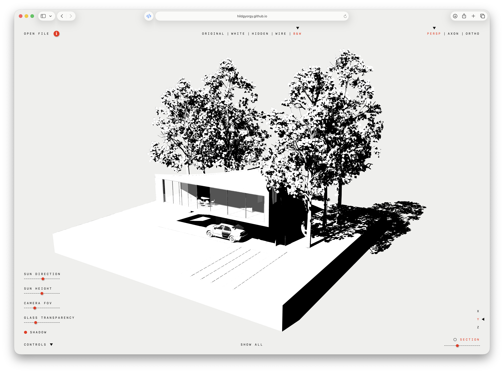

# Drop & View

**Current version: 2.0**



A lightweight browser-based 3D model viewer by **György Hild**. Open a model, explore it, and share the file with a client who can view it without installing a desktop application or creating an account.

**[Open the viewer](https://hildgyorgy.github.io/drop-3d-view/)** · **[Usage guide and support](https://hildgyorgy.github.io/app-support/drop-view/)**

## Getting started

1. Drop a **GLB** file onto the page, or choose **OPEN**. You can also try **DEMO 1** or **DEMO 2** on the start screen; both renderers use the same two files.
2. Drag with the left mouse button to orbit, drag with the right button to pan, and scroll or pinch to zoom.
3. Double-click a point on the model to bring it to the centre of the view.
4. Lost your model while zooming or panning? Choose **ZOOM ALL** at the bottom centre to fit the whole model back into view while keeping the viewing direction, projection and group visibility.

Use a modern browser with JavaScript. The viewer uses WebGL by default; WebGPU is available through the debug renderer selector. Large models may require more memory and a more capable device.

## Views and controls

- **Display styles:** ORIGINAL, WHITE, HIDDEN, WIRE and B&W.
- **PERSP:** perspective viewing with an adjustable field of view.
- **AXON:** an orbitable axonometric view with parallel projection.
- **ORTHO:** TOP, FRONT, LEFT, RIGHT and BACK presets. Elevations can be rotated horizontally while remaining upright and orthogonal. TOP stays fixed. Double-click centring preserves the current ORTHO direction.
- **CONTROLS:** sun direction, sun height, glass transparency and shadows. Camera FOV is available in PERSP; sun and shadow controls are disabled in WIRE.
- **ORBIT / FLY:** orbit around the model, or fly through it with WASD/arrow keys; E/Q changes height. Where pointer lock is unavailable, FLY uses mouse dragging to look around.
- **PATH TRACER:** optional progressive path-traced rendering under ORIGINAL mode. Legacy alpha-blended glass is upgraded to thin physical glass when it can be distinguished safely from masked or texture-backed transparency. SUN DIRECTION is shared by ORIGINAL and PATH TRACER. For GLBs with an exported sun position, both direction and height are shared, and the HDRI lighting aligns with that sun. Without exported sun data, the HDRI retains its native sun height, so SUN HEIGHT adjusts only the regular ORIGINAL sun. The SAMPLES status shows the number of samples per pixel. Compose the view in ORIGINAL mode before activating PATH TRACER; camera controls stay locked while the progressive image refines. The default WebGL renderer uses its own path tracer; the WebGPU path tracer remains available in debug mode.
- **SECTION:** toggle cutting with the circle, choose an X/Y/Z axis and move the section slider to inspect the interior.
- **GROUPS:** show or hide the model's exported top-level groups.

## Material Workbench

The standalone viewer's red **i** panel opens the optional **MATERIAL WORKBENCH**. Select a visible surface to preview SURFACE, POLISHED METAL, LACQUERED or exporter-selected clear GLASS changes. JPEG/PNG base-colour, roughness, OpenGL normal and ARM maps are supported. APPLY changes only the live preview; the source file is never overwritten. For a user-opened editable GLB, **SAVE NEW GLB** downloads a modified copy.

The built-in demos are fully editable for experimentation but cannot be saved. A GLB exported with `asset.extras.dropView.materialWorkbench.policy` set to `disabled` remains view-only and asks the user to request an editable version from its owner. Older files and GLBs without that explicit policy remain editable. The Material Workbench and its code are not loaded in embedded viewers.

## Measurements (experimental)

Toggle **MEASUREMENTS** in the red **i** panel, then drag each black endpoint onto a model surface. The red ruler shows the straight-line 3D distance in metres and adapts its subdivisions to the current view. Endpoints remain attached while orbiting or zooming; only dragging a handle temporarily suspends the camera. Empty-space drops retain the last valid point. Hidden groups and section-clipped surfaces cannot receive endpoints.

The first version provides one measurement, without edge/vertex snapping. Accuracy depends on the GLB's scale and endpoint placement. Switching the tool off preserves the current measurement; opening another model or switching renderers clears it. Measurements are a viewer overlay, are not saved into exported GLBs, and are unavailable in embedded viewers.

### Dormant GLASS LIGHT experiment

The PATH TRACER contains an off-by-default, currently hidden experiment for brightening dark interiors. It makes only the Archicad exporter's explicitly selected Clear Glass materials (`extras.archicad.clearGlassOverride: true`, with physical transmission) emit neutral light; legacy transparent materials and cutouts do not emit. It can improve an interior view when the windows are outside the frame, but visible windows become glowing white panes and convergence can be noisy. The imported GLB and ORIGINAL mode are never changed. To try it again, set `GLASS_LIGHT_EXPERIMENT_ENABLED` to `true` in `js/view/photo1.js`; the GLASS LIGHT button under PATH TRACER will reappear. The experiment remains isolated in `js/view/photo1.js` and `js/model/material-policy.js`, with its dormant button styling in `index.html`, `css/style.css`, `css/adaptive-contrast.css`, and `js/ui/adaptive-contrast.js`.

The three corner menus start closed. Click their labels to open or close them; click the model area or press Escape to close them. The red **i** beside OPEN opens an About panel with Material Workbench, Support and, when included in the GLB, the model's design credits.

### Adaptive menu contrast

When a model is open, the non-red overlay labels use CSS `mix-blend-mode: difference`: they appear dark over light pixels and light over dark pixels without putting panels over the model. Safari sometimes leaves those labels white over the WebGL canvas, so it samples the rendered canvas beneath each label about twice per second and switches that label between crisp dark and white text. This avoids panels and text halos; Safari's switch is per label, not per letter. Red active and hover states, the About button, sliders and coloured controls keep their normal colours. This is a visual aid, not a guaranteed contrast or accessibility threshold; labels can still be faint over mixed or mid-tone areas.

The feature is isolated in [`css/adaptive-contrast.css`](css/adaptive-contrast.css) and [`js/ui/adaptive-contrast.js`](js/ui/adaptive-contrast.js). To switch it off, remove the stylesheet link from `index.html` and the `updateAdaptiveContrast` import/call from `js/main.js`; the viewer then uses its original styling. For a complete code cleanup, also remove the Safari-detection script and the inert `adaptive-text` spans/classes from the slider and toggle labels in `index.html`. These wrappers let only the words blend while the red slider thumbs and toggle indicators remain untouched. The CSS also replaces some `fixed` and transformed positioning with visually equivalent `absolute` positioning while a model is open, because those stacking contexts otherwise prevent the labels from blending with the WebGL canvas—especially in windows at or below 1100 px wide.

If a file cannot be opened, the start screen returns with a red error message in place of the privacy note. Try another file or the demo.

## Model formats

**GLB is the only supported model format.** A self-contained GLB carries geometry and textures in one file and gives the most consistent materials and visual result. Export directly from Archicad with the Drop & View GLB Exporter, or convert another model to GLB before opening it.

GLB files exported with a saved Drop & View initial view open from that viewing direction and projection, automatically zoomed to show the whole model. Files without one still open in the automatically fitted view.

See the [support guide](https://hildgyorgy.github.io/app-support/drop-view/) for export workflows and limitations.

## Privacy and sharing

Your selected model is processed locally in your browser. Drop & View does not upload it to a developer-operated server and requires no account or login.

To share a project, send the model file and the viewer's web address. There is no model-hosting service or uploaded-model sharing link.

The published app serves its renderer packages, environment image and demo from its own website. If a GLB uses Draco compression, the decoder is fetched from jsDelivr. External online converters are separate services with their own upload processes and privacy terms.

### Experimental website embed

An architect can keep a public GLB on their own website and place this classic script at the desired point in an HTML page:

```html
<script
  src="https://hildgyorgy.github.io/drop-3d-view/embed/drop-view-embed.js"
  data-model="/images/projects/tiszato/szabics_03.glb"
  data-title="3D walkthrough"
></script>
```

`data-poster="/path/to/preview.webp"` adds an optional cover image. The GLB URL must be on the **same origin as the architect's page** and end in `.glb`. The script makes a preview button and loads the model only after a click. The host page fetches its own file and passes a browser Blob to a full-screen Drop & View iframe using an origin-checked message; it does not upload the file to Drop & View, and no CORS configuration is needed. The model remains publicly downloadable from the architect's website. The pilot currently uses the normal WebGL viewer and does not change the standalone OPEN/DEMO workflow.

For an interactive model directly in the page, add `data-inline="true"`. The iframe loads near the viewport, allows orbit/zoom without the viewer UI, and expands the **same iframe** to full screen with the usual controls. The model and camera are kept when expanding or returning to the page. The Tisza-tó V3 pilot uses this mode.

## Free to use; proprietary code

The published Drop & View web app is **free to use for personal and commercial projects**, including client work. You retain your rights in your models and may share images of your own work produced with the viewer, subject to any third-party rights in that content.

This is not an open-source licence. Except where applicable law or separate permissions allow it, reusing the application's proprietary code in another product, distributing modified versions, or hosting copies requires prior written permission. Public access to this repository does not grant those rights. GitHub's platform permissions and third-party component licences remain applicable.

See [LICENSE](LICENSE) for the full terms. For permission requests, contact [hild.gyorgy@freemail.hu](mailto:hild.gyorgy@freemail.hu).

## Possible next steps

### Experimental render snapshot transfer

Open the WebGL viewer with `?rendererDebug=1`, then use the info menu's **EXPORT RENDER SNAPSHOT** after loading a GLB and applying any Material Workbench edits. The downloaded `.dvrender` file contains the original GLB bytes, uploaded material images and edit controls, the current camera, lighting controls and group visibility, and the source canvas's physical pixel width and height. On another computer running the same Drop & View build and debug URL, choose **IMPORT RENDER SNAPSHOT** to restore them. The receiving canvas is fitted within its window while retaining the source image's pixel size and camera aspect. Older snapshots without a recorded size still open using the receiving window. These controls are hidden in the normal public view. The original GLB is not modified. Keep the `.dvrender` file private if the model is confidential.

This is the manual scene-reproduction trial. It does not yet send a job over the network, start path tracing automatically, or stop at a specified sample count. Compare the restored scene and WebGL PATH TRACER visually on both computers before adding the render queue. The receiving computer must have the same viewer code and HDRI asset for a meaningful comparison.

In the standalone WebGL viewer, **SAVE IMAGE** appears under **PATH TRACER** after the first sample. It saves the current accumulated path-traced canvas as a PNG without the page controls, whether tracing is running or paused. The source image uses the canvas's actual pixel dimensions; the button does not start a new render or change the camera. The receiving machine's imported canvas size is also used when saving there.

- Real-world sun and shadow studies using the project's geographic location, orientation, date and time.
- More granular visibility controls beyond the current exported top-level groups.

## Local preview

The normal preview uses subtle HDRI lighting and reflections behind a solid background. HDRI loading starts alongside app startup; a model is first shown after its environment is ready, with WebGL's reflection filtering prepared in advance to avoid a later lighting change. If the HDRI fails to load, direct lighting remains available. Like WebGPU and the path tracer, WebGL clamps HDRI values to the finite half-float range before upload, preventing the iOS black-model issue. With `?rendererDebug=1`, WebGL retains **CONTROLS → HDRI LIGHT** for comparison; it starts enabled and does not affect the path tracer's own lighting.

For the author, authorised contributors, or anyone with separate permission to run a local copy, serve the repository over HTTP:

```sh
python3 -m http.server 8000
```

Open `http://localhost:8000`. ES modules require an HTTP server; opening `index.html` directly with a `file://` URL is not sufficient. The published root contains prebuilt WebGPU and WebGL renderer packages under `renderers/`; `AUTO` uses WebGL. The manual comparison selector, including WebGPU, is available only with `?rendererDebug=1`. Without that parameter, the page uses WebGL even if WebGPU was selected during an earlier debug session. To rebuild the packages after source changes, run `pnpm build:public` from `webgpu-lab/` (after `pnpm install`). Do not edit the generated `renderers/` files by hand.

Draco-compressed user GLBs remain supported. Their decoder is fetched on demand from the pinned Three.js CDN version, so opening such a file requires a network connection; no decoder copy is shipped in either renderer package. The two bundled demo GLBs are unchanged and do not use Draco compression.

The baked WebGPU preview calibration also applies outside debug mode. With `?rendererDebug=1` and WEBGPU selected, open the **WEBGPU TUNING** panel at the upper right to adjust it live, including separate glass transparency for WHITE/HIDDEN and B&W. SAVE keeps the values in this browser for later debug sessions; COPY JSON gives you the exact numbers to share or bake into the defaults. RESET restores the current code defaults. The controls are disabled while the path tracer is active.

The model, camera, backend and section logic have automated tests. With Node.js installed, run:

```sh
npm test
```

## Project layout

For a new development chat, start with the [project handoff](PROJECT_HANDOFF.md).

- `index.html` — shared viewer interface and renderer bootstrap
- `renderers/` — generated, same-origin WebGPU and WebGL packages for GitHub Pages
- `webgpu-lab/` — renderer adapters and build scripts for both packages (the old standalone lab page is retired)
- `css/` — layout and visual styling
- `js/core/` — scene, cameras, controls and application state
- `js/model/` — model loading and materials
- `js/view/` — display modes, navigation, framing, lighting and edges
- `js/section/` — clipping, intersection collection, planar contours, fill triangulation and section rendering
- `js/ui/` — menus, messages and model inspection helpers
- `assets/hdri/` — one shared environment image for normal HDRI fill and the path tracers
- `demo/` — sample model used by the viewer
- `test/` — automated tests for model, backend, camera and section logic

## Third-party components

Drop & View uses [Three.js](https://threejs.org/) and [three-gpu-pathtracer](https://github.com/gkjohnson/three-gpu-pathtracer) under their MIT licences, [three-mesh-bvh](https://github.com/gkjohnson/three-mesh-bvh) under its MIT licence, and [Draco](https://github.com/google/draco) under its [Apache 2.0 licence](https://github.com/google/draco/blob/main/LICENSE). PATH TRACER uses the replaceable `assets/hdri/backdrop.hdr` environment image from [Poly Haven](https://polyhaven.com/hdris/pure-skies) under its [CC0 licence](https://polyhaven.com/license). These components and assets retain their own licences; the proprietary terms apply only to the project's own material.

## Contact

Questions, feedback and permission requests: **[hild.gyorgy@freemail.hu](mailto:hild.gyorgy@freemail.hu)**

Copyright © 2026 György Hild.
